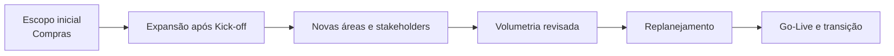
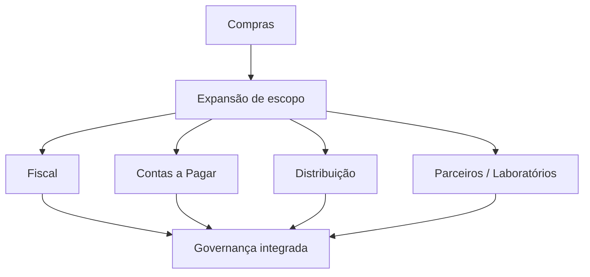
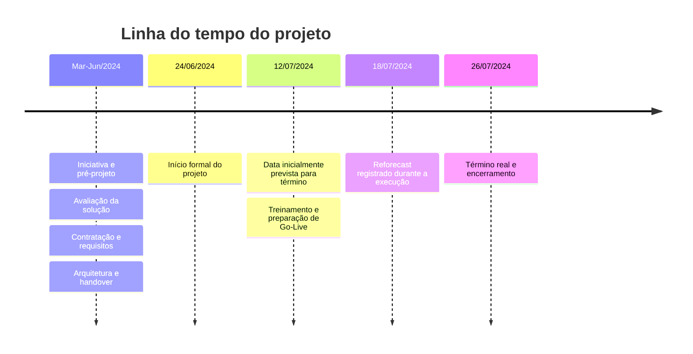
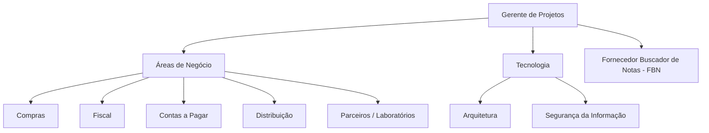
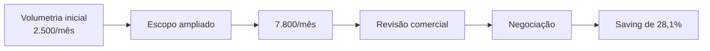
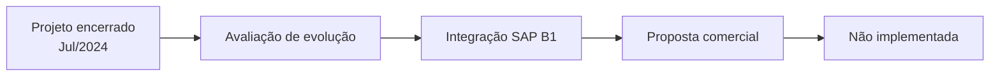

# Automação da Gestão de Documentos Fiscais

### Case de Gerenciamento de Projetos | Transformação Digital | ERP | Automação de Processos

**Gerente de Projetos:** João Henrique Gusmão Esteves  
**Período formal do projeto:** 24/06/2024 a 26/07/2024  
**Abordagem:** Preditiva, com replanejamento durante a execução

> **Confidencialidade:** este case foi reconstruído para fins de portfólio. O nome da empresa cliente, nomes de colaboradores, valores absolutos, credenciais, documentos internos e demais informações sensíveis foram removidos ou anonimizados. O fornecedor da solução é apresentado como **Fornecedor Buscador de Notas (FBN)**.

---

## Visão Geral do Projeto

| Indicador | Resultado |
| :--- | :---: |
| Volumetria inicialmente considerada | **2.500 documentos/mês** |
| Volumetria revisada durante o projeto | **7.800 documentos/mês** |
| Crescimento da volumetria | **+212%** |
| Usuários implantados | **38** |
| Saving obtido na negociação do cenário ampliado | **28,1%** |
| Validações técnicas | **Arquitetura + Segurança da Informação** |
| Go-Live | **Concluído** |
| Operação assistida e handover | **Concluídos** |
| Encerramento formal | **Concluído** |

*Os percentuais de crescimento e saving foram calculados a partir dos dados registrados na documentação original do projeto. Os valores financeiros absolutos não são publicados neste portfólio.*

---

## Contexto e Desafio

A iniciativa teve como objetivo implantar uma solução corporativa para **centralizar, organizar e automatizar a gestão de documentos fiscais eletrônicos**, reduzindo atividades manuais e ampliando controle, rastreabilidade e conformidade.

O escopo funcional abrangia documentos como **NFe, NFSe, CTe, CFe, NFCe e MDFe**, atendendo processos relacionados a Compras, Fiscal, Contas a Pagar, Distribuição e outros públicos internos.

O ambiente corporativo possuía dados provenientes de **SAP** e **Sankhya**, utilizados também como referência para levantamento de volumetria e necessidades de parametrização.

### Principal desafio gerencial

O projeto começou com foco mais concentrado em **Compras**, mas após o Kick-off houve expansão para outras áreas. Essa mudança aumentou a quantidade de stakeholders, a volumetria considerada, os perfis de acesso, as necessidades de parametrização, treinamento e o prazo de entrega.

---

## Meu Papel como GP

Atuei como **Gerente de Projetos**, conduzindo a implantação desde o planejamento formal até o encerramento e transição para a operação.

Minha atuação incluiu:

- planejamento e acompanhamento do cronograma;
- coordenação entre áreas de negócio, Arquitetura, Segurança da Informação e fornecedor;
- gestão da expansão de escopo e dos impactos decorrentes;
- acompanhamento da configuração da solução e dos cadastros necessários;
- coordenação da criação e governança de usuários e perfis de acesso;
- acompanhamento de testes, treinamento e preparação para o Go-Live;
- gestão do replanejamento de datas;
- acompanhamento da operação assistida;
- handover para operação/sustentação;
- encerramento formal e consolidação dos resultados do projeto.

---

## Evolução do Escopo

| Momento | Cenário |
| :--- | :--- |
| **Escopo inicial** | Implantação com foco principal em Compras |
| **Expansão** | Inclusão de Fiscal, Contas a Pagar, Distribuição e outros públicos |
| **Impacto** | Aumento de stakeholders, volumetria, parametrizações e perfis |
| **Resposta do projeto** | Replanejamento, revisão comercial, novos alinhamentos e ampliação da preparação operacional |

---

## Linha do Tempo e Replanejamento

O histórico do projeto demonstra uma diferença clara entre a fase de **iniciativa/pré-projeto** e o período formal de execução.

### Leitura gerencial do cronograma

O desvio não foi tratado apenas como atraso. Houve **reforecast durante a execução**, provocado principalmente pela expansão do projeto para áreas não contempladas inicialmente e pelos ajustes decorrentes dessa ampliação.

---

## Stakeholders e Áreas Envolvidas

A governança exigiu alinhamento entre diferentes áreas com responsabilidades e necessidades distintas, mantendo o GP como ponto de integração entre negócio, tecnologia e fornecedor.

---

## Governança de Acessos

A implantação não se limitou à criação de usuários. Foram definidos **perfis diferenciados de acesso**, associados às responsabilidades de cada área.

Entre as capacidades tratadas estavam:

| Capacidade | Aplicação no projeto |
| :--- | :--- |
| Conferência de documentos | Acesso conforme perfil e responsabilidade |
| Operações em lote | Disponibilização controlada por função |
| Relatórios e dados | Acesso diferenciado por área |
| Manifestação fiscal | Restrita aos perfis aplicáveis |
| Módulo de Compras | Direcionado aos públicos relacionados |
| Administração de usuários | Restrita à governança da plataforma |

**Resultado:** 38 usuários foram implantados com regras de acesso alinhadas às funções de negócio.

---

## Arquitetura e Segurança da Informação

A solução passou por validações internas antes da entrada em produção.

Esse fluxo funcionou como um **gate de governança técnica**, reduzindo o risco de colocar em produção uma solução sem a avaliação das disciplinas responsáveis.

---

## Complexidade de Parametrização

O levantamento utilizou movimentações históricas dos ambientes **SAP** e **Sankhya** para dimensionar a operação e identificar diferentes cenários de captura de NFSe.

Foram encontrados municípios com exigências distintas, como:

- Certificado Digital A1;
- usuário e senha;
- usuário, senha e Inscrição Municipal;
- captura por OCR;
- cenários sem credencial adicional.

Essa diversidade aumentou a complexidade de configuração e exigiu tratamento por cenário, em vez de uma parametrização única para toda a operação.

---

## Gestão do Fornecedor e Custos

A ampliação do escopo alterou significativamente a volumetria considerada para contratação:

### 2.500 → 7.800 documentos/mês
### **+212% de aumento de volumetria**

A revisão do cenário provocou aumento da proposta comercial. Após negociação com o **FBN** e atuação das áreas envolvidas, foi obtido um **saving de 28,1% sobre o custo do cenário ampliado**.

Os valores absolutos foram propositalmente omitidos deste portfólio.

---

## Treinamento, Testes e Go-Live

A preparação para entrada em produção incluiu configuração, cadastros, alinhamentos com usuários-chave, treinamento formal, testes e suporte na transição.

O treinamento foi realizado diretamente com o fornecedor e posteriormente disponibilizado como material de consulta para apoiar a adoção da solução.

---

## Resultados

O encerramento do projeto registrou o atingimento dos objetivos definidos para a implantação.

### Resultados consolidados

- centralização da gestão de documentos fiscais eletrônicos;
- maior controle e rastreabilidade do processo;
- apoio à conformidade fiscal;
- redução de atividades sujeitas a erro manual;
- implantação de 38 usuários com governança de acesso;
- atendimento a múltiplas áreas de negócio;
- validação por Arquitetura e Segurança da Informação;
- treinamento dos usuários envolvidos;
- Go-Live realizado;
- operação assistida e handover para continuidade operacional;
- encerramento formal do projeto.

> O projeto demonstra principalmente a capacidade de **administrar mudança de escopo durante a execução sem perder governança, rastreabilidade e formalização da entrega**.

---

## Lições Aprendidas

A análise do encerramento e dos replanejamentos evidencia alguns aprendizados relevantes:

1. **Validar a abrangência organizacional o mais cedo possível.** A inclusão de novas áreas após o Kick-off impactou prazo, volumetria e configuração.
2. **Dimensionar a volumetria antes de consolidar a baseline comercial.** A revisão de 2.500 para 7.800 documentos/mês exigiu renegociação relevante.
3. **Tratar governança de acesso como entrega do projeto.** Usuários não possuem necessariamente as mesmas necessidades ou responsabilidades.
4. **Usar Arquitetura e Segurança como gates de implantação.** A validação técnica foi parte do caminho para produção.
5. **Planejar a transição para operação.** Treinamento, operação assistida e handover reduziram a ruptura entre projeto e sustentação.

---

## Evolução Pós-Projeto

Após o encerramento da implantação, foi avaliada uma evolução envolvendo **integração adicional com SAP Business One**.

A oportunidade chegou à etapa de avaliação e proposta comercial, porém **não foi implementada**. Ela é registrada aqui apenas como evolução posteriormente estudada, sem ser apresentada como entrega do projeto original.

---

## Tecnologias, Métodos e Disciplinas

  
  
  
  
  
  
  

---

## Sobre este Case

Este repositório apresenta uma **reconstrução profissional e anonimizada** de um projeto concluído em 2024. A documentação corporativa original permanece fora do GitHub e foi utilizada apenas como fonte factual para reconstrução do case.

O objetivo não é reproduzir documentos internos, mas demonstrar **como o projeto foi estruturado, gerenciado, replanejado, implantado e encerrado**.

**João Henrique Gusmão Esteves**  
Gerenciamento de Projetos de Tecnologia | PMO | Transformação Digital

